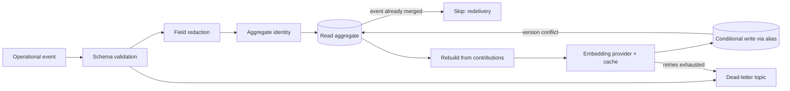

# Semantic indexing

## Aggregates, not raw events

The indexer does not embed every event ([ADR-0004](../adr/ADR-0004-Aggregate-documents-instead-of-raw-event-embeddings.md)).
Each event is merged into one aggregate document, whose ID is
`sha256(tenant | environment | document type | source identity)[:24]`:

| Document type | Event types | Source identity |
| --- | --- | --- |
| `log_template` | `application.error` | service + exception type + masked message template + hour |
| `trace_summary` | `trace.failure`, `application.latency` | `trace.id` (otherwise source + second) |
| `incident` | `incident.created`, `incident.resolved` | `incident.id` |
| `change_event` | `deployment.started`, `deployment.completed` | `changeId` |
| `alert` | `alert.firing`, `alert.resolved` | `alert.name` + hour |
| `network_event`, `operational_signal`, `runbook` | network, Kafka lag, runbook events | source + second |

Templates mask variable values (`<duration>`, `<num>`, `<ip>`, `<id>`), so
`timeout exceeded 30 seconds` and `timeout exceeded 31 seconds` share one template. Events are never
merged across tenants, environments, services or exception types, and different alert names stay
separate even when their wording overlaps.

## Idempotency and ordering

- Each aggregate stores a compact `contributions` record per event (stored, not indexed) and is rebuilt
  from that set on every write. The result depends only on which events were seen, not on delivery
  order, so redelivery and full replays converge on identical documents.
- An event whose ID is already in the aggregate is skipped (`semantic_indexer_duplicate_events_total`).
- Writes are conditional (`if_seq_no`/`if_primary_term`, or `op_type=create` for new documents). A
  conflicting concurrent write is re-read and retried up to three times, then dead-lettered.
- Embeddings are computed from the rebuilt `semantic_text` through an in-process LRU cache, so repeated
  occurrences of an unchanged aggregate cost no embedding calls.

## Index versions

`init-opensearch.sh` installs the `observability-documents-v2` template, creates the index and moves the
`observability-documents` alias to it atomically. v1 documents have a different shape and are not
reindexed: rebuild v2 by replaying Kafka from the earliest offset (locally, `make dev-reset` followed by
`make seed-events`). `schemas/opensearch/reindex-example.json` shows the alias swap on its own.

## Limitations

- `contributions` and `event_ids` grow with occurrences. Hourly buckets bound log templates and alerts,
  but a very noisy template within one hour produces a large document; capping is future work.
- The query API filters on `timestamp`, which is `last_seen`. An aggregate whose activity began inside
  the search window but continued past its end is not matched.
